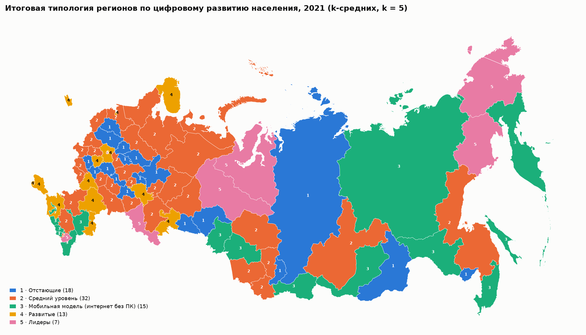
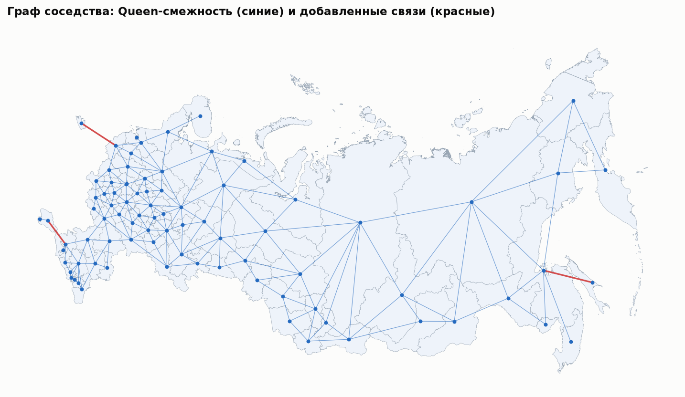
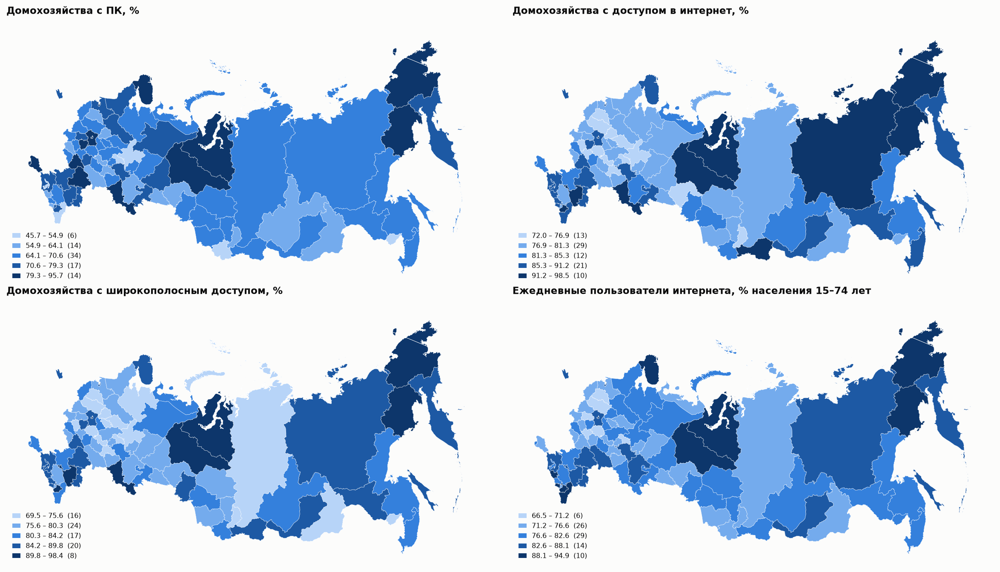
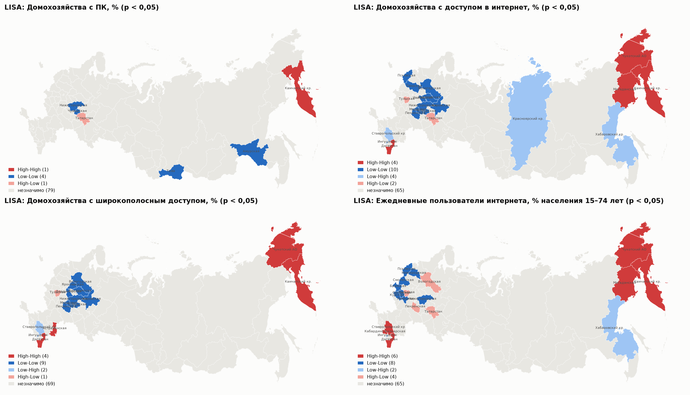
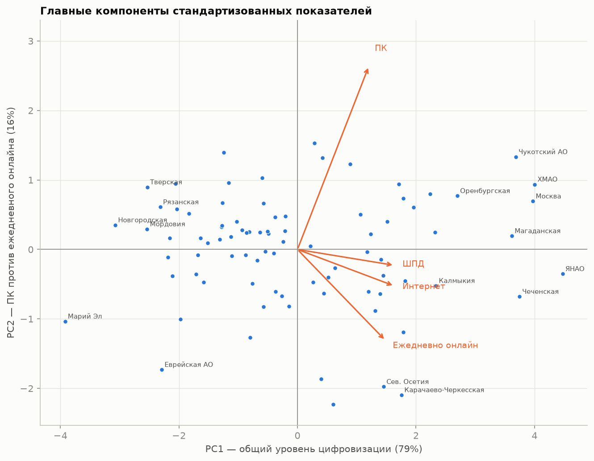
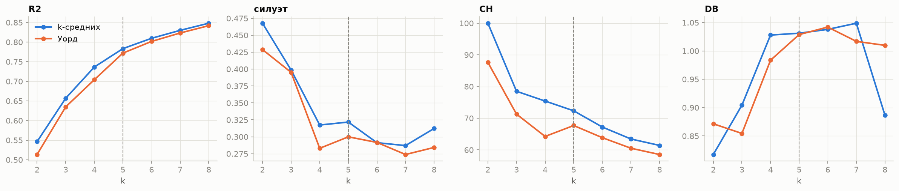
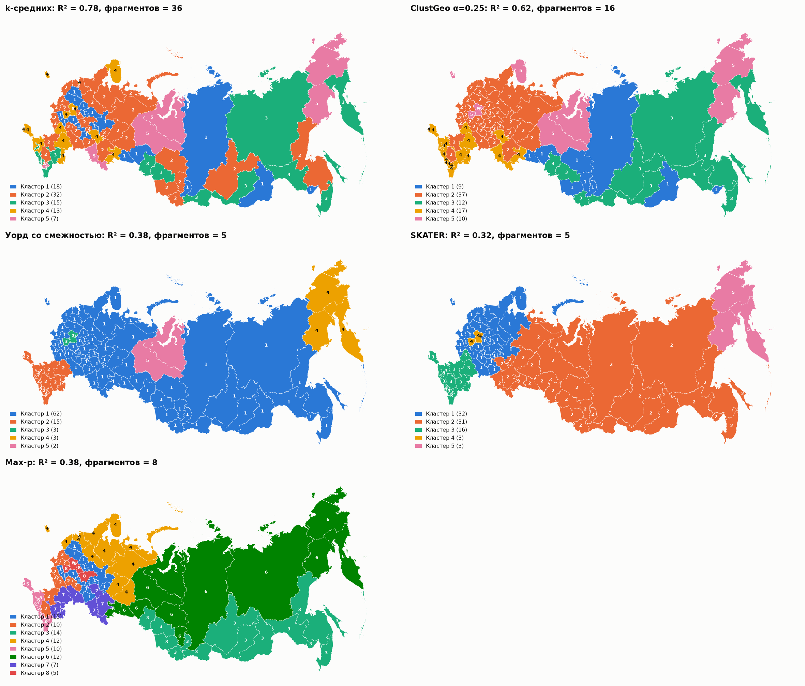
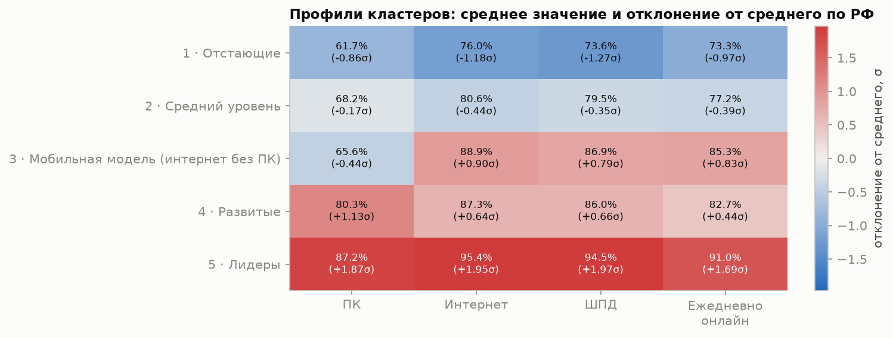
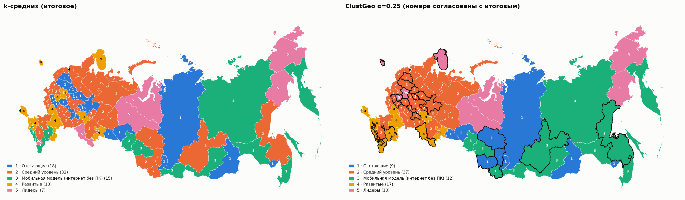

# Цифровое развитие регионов России, 2021: пространственная кластеризация

Проект по практикам 11–12 дисциплины «Анализ данных и машинное обучение» (магистратура 09.04.01, профиль «Искусственный интеллект и анализ данных»).
**Команда 4, вариант «Группа 4. Цифровое развитие регионов»:** Зуев Андрей Александрович, Васильев Александр Викторович, Мамшева Юлия Сергеевна.

**Задача.** Выполнить пространственную кластеризацию субъектов РФ по характеристикам использования цифровых технологий населением, выделить группы со сходным уровнем цифрового развития и исследовать их географическое распределение.

**Главный результат.** Выделено пять типов регионов: «Отстающие», «Средний уровень», «Мобильная модель (интернет без ПК)», «Развитые», «Лидеры». Итоговое разбиение построено методом k-средних (k = 5): $R^2$ = 0,78, силуэт 0,32, устойчивость к ошибке выборки ARI = 0,86. Пространственная автокорреляция показателей значимая, но умеренная: Moran's I от 0,17 до 0,28. Поэтому методы с жёстким требованием связности (Уорд со смежностью, SKATER, Max-p) теряют больше половины однородности: $R^2$ у них 0,32–0,39. Цифровое неравенство в России имеет **мозаичный, а не макрорегиональный** характер. Устойчивые территориальные сгущения есть лишь локально: низкий уровень в Центральной России и Поволжье, высокий — на северо-востоке Дальнего Востока и в части Северного Кавказа.



---

## Содержание
1. [Данные](#1-данные)
2. [Постановка задачи](#2-постановка-задачи)
3. [Пространственные предположения и схема соседства](#3-пространственные-предположения-и-схема-соседства)
4. [Пространственная диагностика](#4-пространственная-диагностика)
5. [Методы кластеризации и параметры](#5-методы-кластеризации-и-параметры)
6. [Сравнение разбиений и выбор итогового](#6-сравнение-разбиений-и-выбор-итогового)
7. [Итоговая типология и её география](#7-итоговая-типология-и-её-география)
8. [Выводы](#8-выводы)
9. [Ограничения](#9-ограничения)
10. [Воспроизведение и структура репозитория](#10-воспроизведение-и-структура-репозитория)

---

## 1. Данные

### 1.1. Показатели

Источник — сборник Росстата «Регионы России. Социально-экономические показатели» в машиночитаемом виде, проект «Если быть точным»: [tochno-st/regions_collection](https://github.com/tochno-st/regions_collection), версия 1.0, раздел 17 «Информационные и коммуникационные технологии». Год — **2021**. Все четыре показателя получены по выборочному обследованию населения по вопросам использования ИКТ (ведётся с 2013 года).

| Код | Показатель | Единица | Обозначение |
|---|---|---|---|
| 17080100 | Удельный вес домашних хозяйств, имевших персональный компьютер | % домохозяйств | `pc` |
| 17080200 | Удельный вес домашних хозяйств, имевших доступ к сети Интернет (с любого устройства) | % домохозяйств | `internet` |
| 17080300 | Удельный вес домашних хозяйств, имевших широкополосный доступ к сети Интернет | % домохозяйств | `broadband` |
| 17090200 | Население, использовавшее Интернет каждый день или почти каждый день | % населения 15–74 лет | `daily_users` |

Численность населения (код 01010000, оценка на конец 2021 года) используется только как ограничение метода Max-p.

### 1.2. Географическая основа

Границы субъектов РФ взяты из OpenStreetMap, набор [timurkanaz/Russia_geojson_OSM](https://github.com/timurkanaz/Russia_geojson_OSM), файл `Russia_regions.geojson`. В нём 85 субъектов в границах на 2021 год, включая Республику Крым и Севастополь. Тип геометрии — Polygon (63) и MultiPolygon (22), система координат WGS 84 (EPSG:4326). Все геометрии валидны, взаимных наложений полигонов площадью больше 1 км² нет.

**Проекция для анализа:** равновеликая коническая проекция Альберса для России `+proj=aea +lat_1=52 +lat_2=64 +lon_0=100 +datum=WGS84`. Она сохраняет площади, что важно для показателя компактности. Чукотка, пересекающая 180-й меридиан, отображается в ней одним массивом.

### 1.3. Объединение, очистка, проверка соответствия территорий

Обработка выполнена в ноутбуке `notebooks/01_data_preparation.ipynb`.

1. **Уровень объектов.** Из данных взяты только строки уровня «регион», без строк «Россия» и федеральных округов. В 2021 году таких строк 87.
2. **Сложносоставные субъекты.** Архангельская и Тюменская области в данных **включают** свои автономные округа (НАО; ХМАО и ЯНАО), а округа дополнительно даны отдельными строками. Чтобы территории не учитывались дважды, для этих двух областей взяты строки «без автономного округа (округов)». Полигоны OSM областей не содержат округов: площадь пересечения равна 0 км². В итоге получено **85 непересекающихся единиц**, покрывающих всю страну. Население этих единиц в сумме 145,56 млн, что совпадает с итогом по РФ в сборнике.
3. **Идентификаторы.** В источнике найдена ошибка: у строки «Архангельская область без АО» ОКТМО равен 11800000 и совпадает с кодом Ненецкого АО. Коды ОКАТО у всех строк уникальны, поэтому **ключ соединения — ОКАТО**.
4. **Привязка границ.** У полигонов OSM есть только название. Названия приведены к написанию Росстата (раскрыты сокращения «обл.» и «АО», явно сопоставлены 10 особых случаев) и сверены с эталонным справочником регионов проекта «Если быть точным» (`regions_etalon.yaml`). Таблица соответствия сохранена в `data/processed/boundary_crosswalk.csv`. Сопоставлены 85 из 85 полигонов, каждый ровно с одной строкой данных (`validate="one_to_one"`).
5. **Пропуски.** Кодов пропуска (`-99999999`) и пустых значений в данных за 2021 год нет.
6. **Упрощение геометрии.** Для карт и хранения применено `shapely.coverage_simplify` с допуском 2 км: общие границы при этом сохраняются. Отношения соседства до и после упрощения совпадают (проверено), а файл уменьшился с 26 до 1,1 МБ.

**Сопоставимость наблюдений.** Три показателя — доли домохозяйств, четвёртый — доля населения 15–74 лет. Все измерены в процентах, но по разной базе и с разным разбросом, поэтому признаки **стандартизуются**. Данные выборочные, их ошибка в малонаселённых регионах больше. Это учтено в проверке устойчивости (раздел 6).

---

## 2. Постановка задачи

**Содержательная.** Разбить субъекты РФ на небольшое число групп так, чтобы внутри группы уровень и структура цифрового развития населения были сходны, а между группами различались. Затем выяснить, образуют ли группы территориальные зоны, и оценить, насколько выбор метода (с учётом или без учёта соседства) меняет классификацию.

**Математическая.** Пусть $n = 85$ регионов, $x_i\in\mathbb R^4$ — вектор показателей региона $i$, $z_i$ — его стандартизованная версия, $z_{iv}=(x_{iv}-\bar x_v)/s_v$. Пространственные отношения задаёт граф соседства $G=(V,E)$ с матрицей $W$. Требуется найти разбиение $\{C_1,\dots,C_k\}$, минимизирующее внутрикластерную неоднородность

$$\min_{C_1,\dots,C_k}\ \sum_{c=1}^{k}\sum_{i\in C_c}\lVert z_i-\bar z_c\rVert^2,$$

в одном из трёх вариантов:
- **без ограничений** — типология (k-средних);
- **с мягким учётом пространства** — к неоднородности по признакам добавляется географическая неоднородность с весом $\alpha$ (ClustGeo);
- **с жёстким ограничением** — каждый $C_c$ должен быть связным подграфом $G$ (Уорд со смежностью, SKATER), а у Max-p дополнительно население каждого кластера не меньше $L$, при этом максимизируется число кластеров $p$.

---

## 3. Пространственные предположения и схема соседства

**Предположение:** регионы, имеющие общую границу, связаны сильнее прочих. У них общая инфраструктура связи, общие операторы и рынки, похожие условия расселения, поэтому сходство цифровых показателей естественно ожидать прежде всего у соседей.

**Основная схема — смежность Queen** (общая граница или вершина) с соединением компонент:
- Калининградская и Сахалинская области не имеют сухопутных соседей среди субъектов РФ, а Крым и Севастополь образуют отдельную компоненту.
- Изолированная часть присоединяется к ближайшему по расстоянию между границами региону другой компоненты: Калининградская — к Псковской (362 км), Сахалинская — к Хабаровскому краю (8 км, Татарский пролив), Крым — к Краснодарскому краю (≈1 км, Керченский пролив).
- В результате граф связный, у региона в среднем 4,5 соседа, минимум 1, максимум 9 (Кировская область). Связность графа обязательна для методов SKATER, Уорда со смежностью и Max-p.

**Альтернативные схемы, на которых проверялась устойчивость:** k ближайших соседей по центроидам (k = 4, 6) и диапазон расстояний. Диапазон отвергнут: при пороге 1 236 км, обеспечивающем хотя бы одного соседа каждому региону, у регионов европейской части оказывается до 52 соседей.



---

## 4. Пространственная диагностика

Расчёты выполнены в ноутбуке `notebooks/02_spatial_diagnostics.ipynb`.

### 4.1. Распределения

| Показатель | Среднее | Ст. откл. | CV, % | Минимум | Максимум | Асимметрия |
|---|---|---|---|---|---|---|
| ПК | 69,8 | 9,4 | 13,4 | 45,7 (Марий Эл) | 95,7 (Чукотский АО) | 0,33 |
| Интернет | 83,3 | 6,2 | 7,4 | 72,0 (Марий Эл) | 98,5 (ЯНАО) | 0,46 |
| ШПД | 81,8 | 6,5 | 7,9 | 69,5 (Новгородская) | 98,4 (ЯНАО) | 0,31 |
| Ежедневно онлайн | 79,8 | 6,7 | 8,3 | 66,5 (Тверская) | 94,9 (ЯНАО) | 0,32 |

Асимметрия мала (|γ₁| < 0,5), поэтому логарифмирование не требуется. Сильнее всего регионы различаются по доле домохозяйств с ПК (CV 13%).



### 4.2. Глобальная автокорреляция

Индекс Морана $I=\frac{n}{S_0}\frac{\sum_i\sum_j w_{ij}z_iz_j}{\sum_i z_i^2}$; при $H_0$ (пространственная случайность) $E[I]=-1/(n-1)=-0{,}012$. Индекс Гири $C=\frac{(n-1)\sum_i\sum_j w_{ij}(x_i-x_j)^2}{2S_0\sum_i (x_i-\bar x)^2}$; значение $C<1$ означает положительную автокорреляцию. Значимость оценивалась перестановочным тестом с 9 999 перестановками, матрица нормирована по строкам.

| Показатель | I (Queen) | p | C (Queen) | p | I (KNN 4) | I (KNN 6) |
|---|---|---|---|---|---|---|
| ПК | 0,213 | 0,003 | 0,694 | < 0,001 | 0,188 | 0,137 |
| Интернет | 0,284 | < 0,001 | 0,688 | < 0,001 | 0,258 | 0,210 |
| ШПД | 0,165 | 0,014 | 0,778 | 0,006 | 0,139 | 0,112 |
| Ежедневно онлайн | 0,249 | 0,001 | 0,682 | < 0,001 | 0,238 | 0,176 |

Автокорреляция **положительная и значимая** по всем показателям и при всех схемах соседства, но **умеренная**. Сходство регионов с соседями заметно, однако далеко не полное. При переходе к более широкому соседству (KNN 6) индекс убывает: связь действует на коротких расстояниях.

### 4.3. Локальная неоднородность

**LISA** (локальный индекс Морана $I_i=\frac{z_i}{m_2}\sum_j w_{ij}z_j$, 9 999 условных перестановок, p < 0,05):
- **High-High** — северо-восток Дальнего Востока: Камчатский край по всем четырём показателям, Чукотский АО по трём, Магаданская область по интернету и ежедневному использованию. Ещё одно сгущение — восток Северного Кавказа: Дагестан по интернету, ШПД и ежедневному использованию; Кабардино-Балкария и Ставропольский край по ежедневному использованию.
- **Low-Low** — массив регионов Центральной России и Поволжья: 8–10 регионов по интернету, ШПД и ежедневному использованию. Чаще других сюда попадают Нижегородская, Кировская, Костромская, Пензенская области, Мордовия и Чувашия. По ежедневному использованию массив смещается на запад: Брянская, Курская, Орловская, Смоленская, Псковская области.
- **Выбросы Low-High** (низкие значения среди высоких у соседей): Ингушетия и Ставропольский край по доступу в интернет, Красноярский и Хабаровский края.
- **Выбросы High-Low** (высокие значения среди низких): Татарстан и Тульская область.

При 85 тестах на уровне 0,05 случайно ожидается около 4 «значимых» регионов. После поправки FDR значимыми остаются 4 региона по интернету, 3 по ШПД, 1 по ежедневному использованию и ни одного по ПК. Локальные структуры есть, но их немного.



**Многомерный локальный индекс Гири** по всем четырём признакам: $c_i=\frac{1}{p}\sum_v\sum_j w_{ij}(z_{vi}-z_{vj})^2$. По нему 13 регионов значимо похожи на соседей, 6 значимо отличаются от них, у 66 различие с окружением незначимо. Однородных территориальных зон мало, поэтому заранее можно ожидать высокой «цены» требования связности.

### 4.4. Связь признаков и преобразование

Интернет и ШПД почти дублируют друг друга (r = 0,96), с ежедневным использованием они связаны тесно (r = 0,80–0,83), с наличием ПК — умеренно (r = 0,42–0,62).

Метод главных компонент по z-оценкам:
- **PC1** объясняет 78,5% дисперсии и отражает общий уровень цифровизации (все нагрузки 0,40–0,55).
- **PC2** объясняет 15,6% и противопоставляет **наличие ПК** (+0,88) **ежедневному онлайну** (−0,44). Это ось «компьютерная модель — мобильная модель» цифровизации.
- Обе компоненты пространственно автокоррелированы: I = 0,23 и 0,25, p ≤ 0,002.

**Решения:**
- основное пространство признаков — четыре z-оценки, так сохраняется прямая интерпретация;
- проверка чувствительности — пространство двух первых главных компонент (94% дисперсии);
- выбросы (ЯНАО, ХМАО, Чукотка, Якутия, ЕАО, Марий Эл; |z| > 2,5 или расстояние Махаланобиса выше 0,99-квантиля χ²₄) не удаляются: это реальные регионы с особым профилем.



---

## 5. Методы кластеризации и параметры

Реализация — в ноутбуке `notebooks/03_clustering.ipynb`.

| № | Метод | Учёт пространства | Параметры и реализация |
|---|---|---|---|
| 1 | **k-средних** | нет | k = 5, k-means++, 200 стартов; `sklearn.cluster.KMeans` |
| 2 | **ClustGeo** (Chavent и др., 2018) | мягкий | Уорд на $D_\alpha=\sqrt{(1-\alpha)D_0^2+\alpha D_1^2}$, где $D_0$ — евклидовы расстояния между z-оценками, $D_1$ — число границ на кратчайшем пути в графе соседства (обе матрицы нормированы на максимум); α = 0,25; `scipy.cluster.hierarchy.linkage(method="ward")` |
| 3 | **Уорд со смежностью** | жёсткий | объединяются только соседние кластеры; `AgglomerativeClustering(linkage="ward", connectivity=W)` |
| 4 | **SKATER** (Assunção и др., 2006) | жёсткий | минимальное остовное дерево с весами $\lVert z_i-z_j\rVert$, $k-1$ разрезов; не меньше 3 регионов в кластере; `spopt.region.Skater` |
| 5 | **Max-p** (Duque и др., 2012) | жёсткий, $p$ подбирается | население кластера не меньше 15 млн (≈10% населения РФ, масштаб федерального округа); `spopt.region.MaxPHeuristic` |

**Выбор k = 5.** Для k-средних и Уорда при k = 2…8 сравнивались $R^2$, силуэт, индексы Калински–Харабаша и Дэвиса–Болдина (`results/03_k_selection.csv`).
- Максимум силуэта при k = 2 (0,47) соответствует тривиальному делению «выше/ниже среднего».
- Среди k ≥ 3 силуэт k-средних максимален при k = 5 (0,322).
- На кривой $R^2$ при k = 5 «локоть»: прирост от 4 к 5 кластерам составляет +4,7 п. п., дальше по 2–3 п. п.
- Наименьший кластер содержит 7 регионов.

Методы 1–4 строятся при k = 5, Max-p сам определил p = 8.

**Выбор α для ClustGeo.** По критерию авторов метода строятся доли объяснённой неоднородности: по признакам $Q_0(\alpha)$ и по географии $Q_1(\alpha)$, каждая нормирована на свой максимум. При α = 0,25 нормированные кривые пересекаются (0,80 и 0,77). Это значит, что потеря признаковой однородности уравновешена выигрышем географической.



---

## 6. Сравнение разбиений и выбор итогового

**Система показателей** (все результаты в `results/04_summary_metrics.csv`):

| Группа | Показатель | Смысл |
|---|---|---|
| Качество | $R^2=1-SS_W/SS_T$, силуэт | однородность групп по признакам |
| Устойчивость | средний ARI при возмущении данных шумом σ = 1 и 2 п. п. (30 повторов, для Max-p 10) | влияние ошибки выборочного обследования |
| Пространство | число связных фрагментов кластеров; доля пар соседей с одинаковой меткой; путевой силуэт (Wolf и др., 2021) | территориальная целостность |
| Интерпретируемость | минимальный размер кластера; минимальное расстояние между центрами кластеров (в σ) | нет вырожденных кластеров, типы различимы |

| Метод | $R^2$ | Силуэт | ARI (σ=1) | ARI (σ=2) | Фрагменты | Связи внутри | Путевой силуэт | Мин. размер | Мин. разрыв центров, σ |
|---|---|---|---|---|---|---|---|---|---|
| **k-средних** | **0,783** | **0,322** | **0,858** | 0,669 | 36 | 0,307 | −0,098 | 7 | **1,48** |
| ClustGeo α=0,25 | 0,616 | 0,016 | 0,742 | 0,648 | 16 | 0,604 | 0,153 | 9 | 0,58 |
| Уорд со смежностью | 0,381 | 0,109 | 0,762 | 0,667 | 5 | **0,875** | 0,075 | 2 | 0,64 |
| SKATER | 0,322 | −0,049 | 0,752 | **0,694** | 5 | 0,839 | **0,266** | 3 | 0,64 |
| Max-p (p = 8) | 0,385 | −0,121 | 0,551 | 0,540 | 8 | 0,510 | 0,108 | 5 | 0,18 |

Средние ранги по четырём группам критериев (1 — лучший): k-средних 2,25; SKATER 2,81; Уорд со смежностью 2,85; ClustGeo 3,00; Max-p 4,08.

Дополнительно:
- **Чувствительность к пространству признаков:** ARI между разбиениями по четырём z-оценкам и по двум главным компонентам составил 0,98 у k-средних, 0,96 у Уорда со смежностью, 0,62 у Max-p, 0,55 у ClustGeo и 0,42 у SKATER.
- **Худшие случаи устойчивости:** минимальный ARI по повторам у Уорда со смежностью 0,05–0,06, у SKATER 0,16–0,18. Отдельные возмущения данных полностью перестраивают их разбиение.



**Выбор: итоговое разбиение — k-средних (k = 5).**

1. Цель задания — выделить **группы со сходным уровнем** цифрового развития и затем изучить их географию. Значит, в первую очередь нужна однородная и устойчивая типология. По качеству, устойчивости, чувствительности и интерпретируемости k-средних лучший.
2. Методы с жёсткой связностью объясняют лишь 32–39% дисперсии против 78%, то есть «цена» связности — больше половины однородности. Уорд со смежностью к тому же даёт вырожденную структуру: кластер из 62 регионов и кластеры по 2–3 региона. Max-p при пороге 15 млн выделяет 8 макрорегионов, но два самых близких из них почти неразличимы по профилю (0,18σ). Это согласуется с диагностикой: при Moran's I ≈ 0,2 и всего 13 регионах, похожих на соседей (локальный Гири), сплошных однородных зон в данных нет.
3. ClustGeo (α = 0,25) — разумный компромисс для **картографического** представления: вдвое больше связей внутри кластеров (0,60 против 0,31) и вдвое меньше фрагментов при $R^2$ = 0,62. Однако силуэт около нуля и меньшая устойчивость не позволяют сделать его основным. Он используется как дополнительная «территориальная» версия типологии (раздел 7.3).

---

## 7. Итоговая типология и её география

Расчёты выполнены в ноутбуке `notebooks/04_results.ipynb`. Номера кластеров упорядочены по общему уровню цифровизации (среднее PC1).

| Кластер | Регионов | Население, млн | ПК | Интернет | ШПД | Ежедневно онлайн |
|---|---|---|---|---|---|---|
| 1 · Отстающие | 18 | 18,4 | 61,7 | 76,0 | 73,6 | 73,3 |
| 2 · Средний уровень | 32 | 54,9 | 68,2 | 80,6 | 79,5 | 77,2 |
| 3 · Мобильная модель (интернет без ПК) | 15 | 16,3 | 65,6 | 88,9 | 86,9 | 85,3 |
| 4 · Развитые | 13 | 37,5 | 80,3 | 87,3 | 86,0 | 82,7 |
| 5 · Лидеры | 7 | 18,5 | 87,2 | 95,4 | 94,5 | 91,0 |



**Состав кластеров:**
1. **Отстающие** (все показатели на 0,9–1,3σ ниже среднего): Ивановская, Кировская, Костромская, Курганская, Липецкая, Новгородская, Орловская, Рязанская, Тверская, Ульяновская, Ярославская, Тюменская (без АО) области, Марий Эл, Мордовия, Хакасия, Красноярский и Забайкальский края, Еврейская АО.
2. **Средний уровень** (немного ниже среднего): большинство регионов Центра, Северо-Запада, Поволжья, Урала и юга Сибири, всего 32. Полный список — в `results/04_final_classification.csv`.
3. **Мобильная модель**: доступ в интернет и ежедневное использование выше среднего на 0,8–0,9σ, а доля домохозяйств с ПК ниже среднего на 0,4σ. Сюда вошли республики Северного Кавказа (Дагестан, Кабардино-Балкария, Карачаево-Черкесия, Северная Осетия, Адыгея, Калмыкия), Сибири и Дальнего Востока (Бурятия, Тыва, Якутия), а также Приморский и Камчатский края, Амурская, Сахалинская, Новосибирская и Омская области. Это тип, который отличает от остальных вторая главная компонента: интернет здесь используется в основном со смартфонов.
4. **Развитые** (особенно высокая доля ПК, +1,1σ): Московская область и Санкт-Петербург, Краснодарский край, Крым и Севастополь, Татарстан, Калининградская, Мурманская, Тульская, Челябинская, Воронежская, Волгоградская и Астраханская области.
5. **Лидеры** (все показатели на 1,7–2,0σ выше среднего): Москва, ХМАО, ЯНАО, Чукотский АО, Магаданская и Оренбургская области, Чечня.

### 7.1. Распределение по федеральным округам

| Федеральный округ | Отстающие | Средний | Мобильная | Развитые | Лидеры |
|---|---|---|---|---|---|
| Центральный | 7 | 7 | 0 | 3 | 1 |
| Северо-Западный | 1 | 7 | 0 | 3 | 0 |
| Южный | 0 | 1 | 2 | 5 | 0 |
| Северо-Кавказский | 0 | 2 | 4 | 0 | 1 |
| Приволжский | 4 | 8 | 0 | 1 | 1 |
| Уральский | 2 | 1 | 0 | 1 | 2 |
| Сибирский | 2 | 5 | 3 | 0 | 0 |
| Дальневосточный | 2 | 1 | 6 | 0 | 2 |

«Мобильная модель» встречается только на Северном Кавказе, в Южном ФО, Сибири и на Дальнем Востоке. «Отстающие» сосредоточены в Центральной России и Поволжье (11 из 18). «Развитые» — регионы с крупнейшими агломерациями и курортно-туристическим югом.

### 7.2. Территориальная связность типов

Проверка выполнена тестом числа соединений (join count, 9 999 перестановок): сравнивается, сколько пар соседних регионов оба входят в кластер, с ожидаемым при случайном размещении меток.

| Кластер | BB наблюдаемое | BB ожидаемое | p |
|---|---|---|---|
| Отстающие | 13 | 8,2 | 0,064 |
| Средний уровень | 33 | 26,6 | 0,100 |
| Мобильная модель | 6 | 5,7 | 0,49 |
| Развитые | 5 | 4,2 | 0,40 |
| Лидеры | 2 | 1,1 | 0,31 |

Ни один тип не образует статистически значимого территориального сгущения на уровне 0,05. Ближе всего к нему «Отстающие» (p = 0,06): это центральнороссийский массив, найденный и LISA. Остальные типы разбросаны по стране, что объясняет мозаичность карты и высокую «цену» связности.

### 7.3. Территориальная версия (ClustGeo)

При учёте географии с весом α = 0,25 совпадают 53 из 85 регионов. Тип меняют прежде всего регионы, выбивающиеся из окружения:
- северокавказские республики объединяются с соседним югом в одну зону;
- Москва и Санкт-Петербург объединяются со своими областями в столичные зоны;
- «отстающие» регионы Центра поглощаются окружающим «средним уровнем».



**Пограничные регионы.** Отрицательный силуэт только у двух регионов из 85: Новосибирской и Оренбургской областей. Типология в целом чёткая.

---

## 8. Выводы

1. **Уровень цифрового развития населения регионов в 2021 году высок и относительно однороден:** доступ в интернет от 72 до 98,5% домохозяйств. Главные различия связаны с общим уровнем (PC1, 78,5% дисперсии) и со структурой цифровизации: «компьютерная» или «мобильная» модель (PC2, 15,6%).
2. **Пространственная зависимость значимая, но умеренная** (I = 0,17–0,28, устойчиво к выбору матрицы соседства). Локальные сгущения: низкие значения в Центре и Поволжье, высокие на северо-востоке Дальнего Востока и в восточной части Северного Кавказа.
3. **Пять типов регионов** надёжно выделяются методом k-средних. Разбиение устойчиво к ошибке выборки (ARI 0,86) и к выбору пространства признаков (ARI 0,98).
4. **Цифровое неравенство мозаично, а не макрорегионально.** Методы с требованием территориальной связности теряют больше половины однородности. Ни один тип, кроме пограничного случая «Отстающих», не образует значимого территориального сгущения. Для политики цифрового развития это означает адресную работу с конкретными регионами, а не программы по федеральным округам.
5. **Высокие показатели имеют разную природу.** Северные ресурсные регионы и Москва (высокие доходы, плотная инфраструктура) попадают в тот же тип, что и Чечня, где доля пользователей по самооценкам в обследовании тоже очень высока. Типология фиксирует **уровень использования**, а не его причины.

## 9. Ограничения

- **Выборочные данные.** Показатели получены по выборочному обследованию, и в малонаселённых регионах (НАО, Чукотка, ЕАО) ошибка выборки больше. Устойчивость проверялась возмущением ±1–2 п. п., но фактическая ошибка Росстатом в сборнике не публикуется. Ответы респондентов — самооценки, поэтому возможны региональные различия в манере отвечать.
- **Один год.** Типология описывает 2021 год, динамику и причинность по ней оценить нельзя.
- **Масштаб и MAUP.** Субъекты сильно различаются по площади и населению: от Севастополя до Якутии. Сходство «соседей» на западе и на востоке страны имеет разный физический смысл, а внутрирегиональные различия (город — село) скрыты.
- **Границы OSM.** Полигон Москвы в наборе дан в границах до 2012 года (≈1,1 тыс. км² против ≈2,56 тыс.), а у приморских субъектов площади включают акватории. На показатели и соседство это не влияет: статистика относится к актуальным границам, отношения соседства не меняются. Сказывается только на картах и на показателе компактности.
- **Искусственные связи.** Связи Калининград — Псков, Сахалин — Хабаровский край и Крым — Краснодарский край добавлены для связности графа и не означают реального соседства.
- **Новые субъекты.** Субъекты, принятые в состав РФ в 2022 году, в данные за 2021 год не входят.
- **Метод k-средних** предполагает сферические кластеры сходного размера. Устойчивость к этому допущению подтверждена совпадением с Уордом без ограничений (близкие $R^2$ при всех k) и с разбиением в пространстве главных компонент.

---

## 10. Воспроизведение и структура репозитория

```
README.md                 аналитический отчёт (этот файл)
requirements.txt          версии библиотек (Python 3.12.10)
data/
  raw/                    исходные строки по 4 показателям (все годы) и численность населения 2021
    _source/              кэш тяжёлых исходных файлов (не хранится в git, скачивается ноутбуком 01)
  processed/              геопространственная база: regions_digital_2021.gpkg (85 полигонов, AEA),
                          regions_digital_2021.csv, boundary_crosswalk.csv (соответствие названий OSM и ОКАТО)
notebooks/                01 → 04, выполненные .ipynb; рядом .py-версии (jupytext) для удобного просмотра изменений
src/common.py             пути, проекция, коды, матрица соседства, метрики разбиений
src/viz.py                единый стиль карт и графиков
results/                  таблицы метрик, меток кластеров и итоговая классификация (CSV, GPKG)
maps/                     все карты и графики (PNG)
presentation/             презентация для защиты на 10 минут (PPTX и PDF, 12 слайдов, заметки докладчиков в PPTX)
```

**Порядок воспроизведения:**

```bash
python -m venv .venv && .venv/Scripts/activate        # Linux/macOS: source .venv/bin/activate
pip install -r requirements.txt
cd notebooks
for nb in 01_data_preparation 02_spatial_diagnostics 03_clustering 04_results; do
  jupyter nbconvert --to notebook --execute --inplace $nb.ipynb
done
```

- Ноутбук 01 сам скачивает архив сборника (6,6 МБ), справочник регионов и границы (52 МБ) в `data/raw/_source/`.
- Архив RAR распаковывается командой `tar` (Windows 10+ или libarchive) или `7z`.
- Все случайные процессы зафиксированы (`SEED = 2021`). Полный прогон занимает несколько минут, больше всего времени уходит на проверку устойчивости в ноутбуке 03.

**Источники:**
- Росстат. Регионы России. Социально-экономические показатели (машиночитаемая версия): https://github.com/tochno-st/regions_collection
- Границы субъектов РФ (OpenStreetMap): https://github.com/timurkanaz/Russia_geojson_OSM
- Chavent M., Kuentz-Simonet V., Labenne A., Saracco J. ClustGeo: an R package for hierarchical clustering with spatial constraints // Computational Statistics. 2018. Vol. 33. P. 1799–1822.
- Assunção R. M. et al. Efficient regionalization techniques for socio-economic geographical units using minimum spanning trees // International Journal of Geographical Information Science. 2006. Vol. 20, № 7.
- Duque J. C., Anselin L., Rey S. J. The max-p-regions problem // Journal of Regional Science. 2012. Vol. 52, № 3.
- Anselin L. A local indicator of multivariate spatial association: extending Geary's c // Geographical Analysis. 2019. Vol. 51, № 2.
- Wolf L. J., Knaap E., Rey S. Geosilhouettes: geographical measures of cluster fit // Environment and Planning B. 2021. Vol. 48, № 3.
